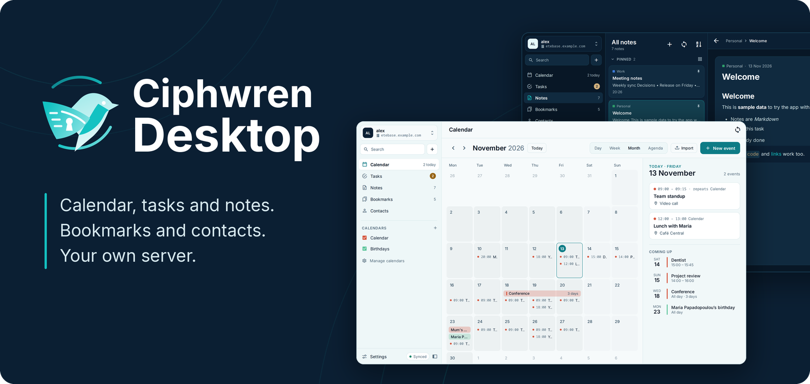
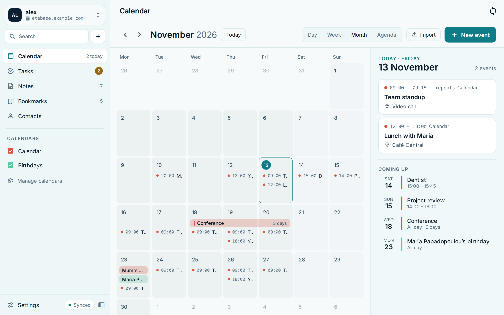
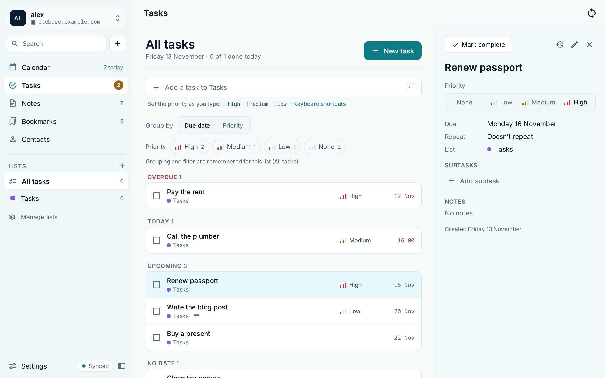
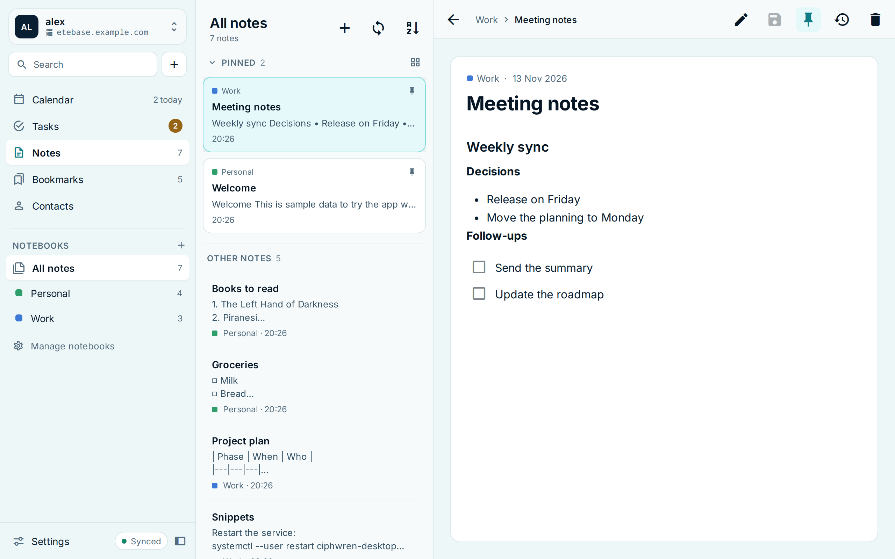
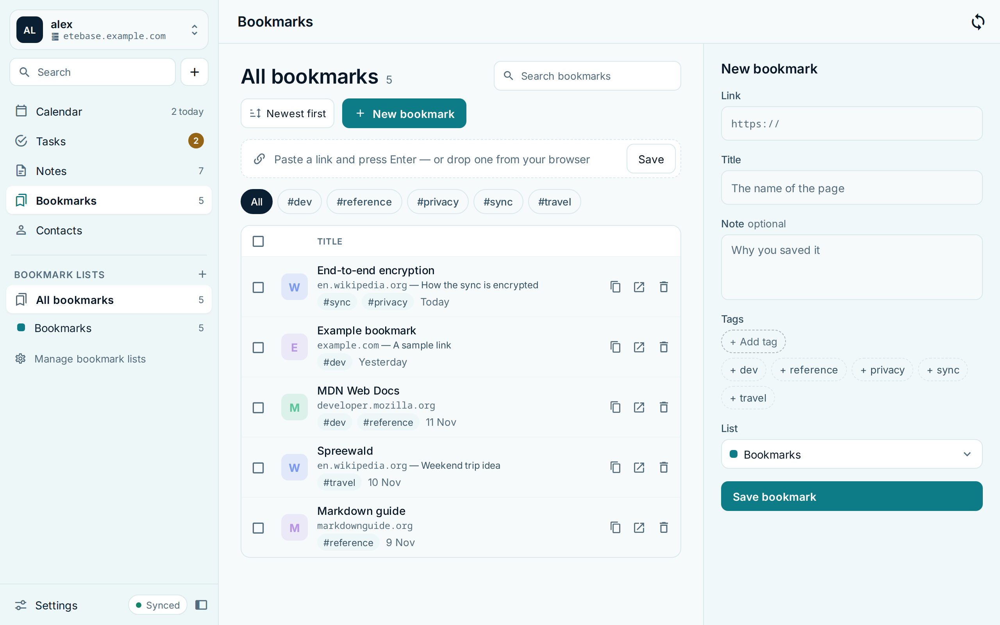
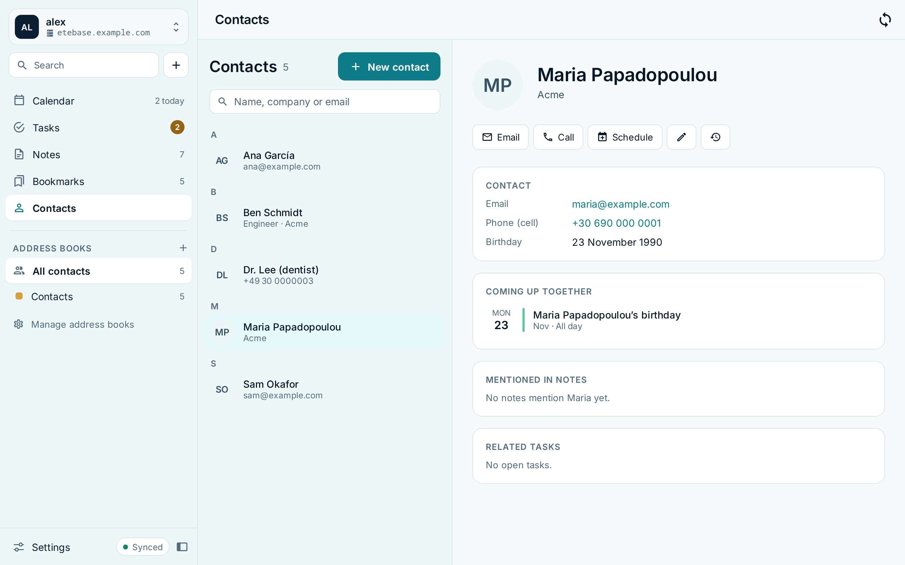
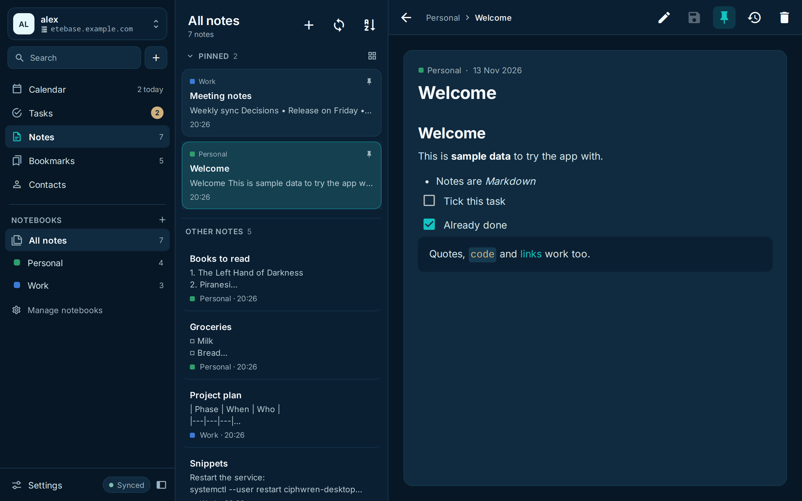

<p align="center">
  
</p>

<p align="center">
  End-to-end encrypted calendar, tasks, notes, bookmarks and contacts for the Linux desktop.<br />
  Works offline. Syncs with an Etebase server you run yourself.
</p>

<p align="center">
  <a href="#installing-it"><strong>Install on Linux</strong></a>
  &nbsp;·&nbsp;
  <a href="#whats-in-it">What's in it</a>
  &nbsp;·&nbsp;
  <a href="#security-and-privacy">Security and privacy</a>
  &nbsp;·&nbsp;
  <a href="#development">Development</a>
</p>

## Everything in one private place

| Plan your time | Write and save | Keep control |
| --- | --- | --- |
| A calendar with day, week, month and agenda views, repeating events, reminders and time zones. | Markdown notes in notebooks, with pinned notes, search and earlier versions. | End-to-end encryption with an Etebase server you run yourself. |
| Tasks with priorities, due dates, subtasks and lists. | Bookmarks with lists and tags. Tracking parameters such as `utm_source` and `fbclid` are removed from saved links. | Work offline; changes sync when the connection is back. |
| Contacts in address books and groups, with the events, notes and tasks about them. | Import and export `.ics`, `.vcf`, Markdown and browsers' bookmark files. | The app talks to your server only. A bookmark's page is fetched just when you ask for its title. |

<details>
<summary>Explore the app — full-size screenshots</summary>

Select an image to view it at full size.

| Calendar | Tasks | Notes |
| :---: | :---: | :---: |
| [](.github/screenshots/calendar.png) | [](.github/screenshots/tasks.png) | [](.github/screenshots/notes.png) |

| Bookmarks | Contacts | Dark mode |
| :---: | :---: | :---: |
| [](.github/screenshots/bookmarks.png) | [](.github/screenshots/contacts.png) | [](.github/screenshots/dark-mode.png) |

</details>

## Installing it

On Linux, with Python 3 and a browser (Chromium, Chrome, Brave, Edge or Firefox):

```
curl -fsSL https://raw.githubusercontent.com/nikossvnk/ciphwren-desktop/main/desktop/get.sh | sh
```

It downloads the latest release (the built app, about 2.5 MB) from this repository's GitHub
releases, checks its checksum, and installs it in your home directory, with "Ciphwren Desktop" in
the applications menu. It runs on `http://localhost:8092`, only reachable from
this computer. Then log in with your server's URL (under "Advanced settings"), e.g.
`https://etebase.example.com`.

- **Updating:** run the same line again.
- **Without systemd,** or to not have a service started at login: `curl … | SERVICE=no sh`. The
  shortcut then starts the server when it's opened.
- **A shortcut on the desktop:** `~/.local/share/ciphwren-desktop/install.sh --desktop-icon` (any time
  after installing; `--no-desktop-icon` removes it), or `curl … | DESKTOP_ICON=yes sh`.
- **Trying it without installing:** download `ciphwren-desktop-VERSION.tar.gz` from the releases,
  unpack it, and run `./ciphwren-desktop` in it.
- **Removing it:** `~/.local/share/ciphwren-desktop/install.sh --uninstall`

More options (port, browser) and how releases are made are in `desktop/README.md`.

## What's in it

### Sidebar

- The account, one search for notes, events, tasks and contacts, and a "+" to make any of them (and
  a bookmark).
- The five sections: Calendar, Tasks, Notes, Bookmarks and Contacts, with live counts (events today,
  tasks due, notes, bookmarks). Alt+1 to Alt+5 go to them.
- `?` (when not typing) or Ctrl+/ shows the keyboard shortcuts and what can be typed. The list is
  also in the account menu, and linked under the box for new tasks.
- Under the sections, a list about the open one: notebooks, bookmark lists, calendars to show and
  hide (and the birthdays of contacts), task lists, address books and contact groups.
- At the bottom: the settings, the sync state, and a button that hides the sidebar.
- In a narrow window the sections are in a menu instead.

### Calendar

- Day, week, month and agenda views. Weeks start on Monday or Sunday, by the setting.
- **Month:** weekends apart, events with a time as a dot and the time, all day ones as bars joining
  over their days. Next to it, the chosen day's events (place, who comes) and what's coming up.
  Events of several days are bars over their days, on lines of their own when they overlap, with an
  arrow where they go on into the next week.
- **Week:** the hours of seven days, the all day events as bars over them, and the chosen event's
  details next to it.
- **Day:** the hours with each event's place and who comes, a small month to go to another day, and
  the tasks due that day.
- **Agenda:** the next four weeks by day, with the next event marked. Repeating events are hidden
  unless asked for.
- Choosing an empty hour makes an event then. Events can be dragged to another time and day, and
  their lower edge to change when they end.
- **Repeating events:** the times that were changed or cancelled (here or in another app) are shown
  as they are. Editing, dragging or deleting one time asks whether that's for only this time or all
  of them, and the changed and cancelled times stay with the event when all of its times move.
- **Time zones:** an event's times are in its time zone, and the editor says when they are where you
  are. Any time zone the browser knows works. Its rules are saved with the event, as other calendars
  read them, and an event's times are never saved without one.
- **Attendees:** who's invited is shown, and can be added from the contacts.
- **Reminders:** before the start, or at a time of the day for all day events. They're saved as
  other calendar apps expect them (VALARM), so those show them too, and the ones made there are shown
  and kept. When they're due they're notifications of the computer (see `desktop/README.md`).
- "Import", next to "New event", imports `.ics` files (and the other kinds).
- A calendar's ⋯ menu has "Delete old events…". It deletes the events that happened once and ended
  more than a year ago, after asking. Repeating events are kept, even old ones.

### Tasks

- Adding from the top: "!high", "!medium" or "!low" in the title sets the priority.
- The tasks in Overdue, Today, Upcoming and No date, or grouped by priority, with today's progress.
  A day's tasks are sorted by priority, then the ones due all day before the ones at a time.
- Each task shows its list, its subtasks, its priority (bars and a word) and when it's due.
- The priorities can be filtered, with how many open tasks each has. Each list remembers its grouping
  and filter.
- The done ones are folded away at the bottom (the last one done first), shown with "Show completed"
  and deleted with "Delete completed" (the ones shown, after asking). Marking one as done can be
  undone.
- Next to the list, the chosen task's details: its priority (changed with one click), due date,
  reminders, repeat, list, its subtasks to tick off and add, and its notes. There's also an editor
  for all of it.
- A right click on a task has "Edit" and "Delete".
- Priorities are read as other apps write them (1–4 high, 5 medium, 6–9 low), and a task's own value
  is kept until its priority is changed here.
- Repeating tasks get their next time when done. Reminders are relative to the due date.
- **Tasks in the calendar:** "Add to calendar" in the editor makes an event for a task with a due
  date, on its due day (or an hour from its due time), without reminders. The event follows the
  task: its title gets a "✓ " while the task is done, it moves with the due date, and it's deleted
  with the task, with its due date, or when the box is unticked. The next time of a repeating task
  gets an event of its own. The day view's "Tasks due" leaves out the tasks whose event is there.
  The two are linked in the synced data (`X-CIPHWREN-EVENT` on the task, `X-CIPHWREN-TASK` on the
  event), so every device keeps them together.

### Notes

- The notes are in a column next to the sidebar, with the chosen notebook's notes or all of them.
- **Pinned notes** are above the others, under a "Pinned" title that folds them away. They're cards
  as wide as the list, with the beginning of the note; the button next to the title shows them two
  per row. The others are under "Other notes".
- A note is pinned with the pin in its bar. Several are pinned at once by selecting them with
  Ctrl-click (or a long press on a touch screen), then "Pin selected". The pin is in the note's
  encrypted metadata, the same as in Ciphwren Notes, and pinning doesn't change when the note was
  modified.
- A right click on a note, or on the selected ones, pins or unpins them, moves them to another
  notebook or deletes them.
- **Editor shortcuts:** Ctrl+B bold, Ctrl+I italic, Ctrl+E code, Ctrl+K link, Ctrl+Shift+X
  strikethrough, Ctrl+Shift+7/8/9 numbered, bulleted and check lists, Ctrl+Shift+. quote and
  Ctrl+Shift+H heading. Undo takes them back, and "`" puts the selected text in code.
- **Pasting:** text pasted with its formatting (from a web page, a document or a mail: bold, italics,
  headings, lists, quotes, code, links, tables) is put in as Markdown. Text without any, such as code
  from an editor, is pasted as it is.
- **Copying:** text copied from the viewer keeps its formatting (bold, italics, strikethrough, code,
  the size of headings) but not the theme's colours, so it isn't pasted elsewhere as light text on a
  dark background. Ctrl+A there selects the note's text, not the whole page.
- Settings → "Export Notes" saves all notes as Markdown files in a zip, with a folder for every
  notebook, and "Import Notes" reads such a zip.

### Bookmarks

- A link is saved by pasting it in the bar at the top and pressing Enter, or by dropping it from the
  browser. It's saved right away, and shown by its site until it has a title. "Get title" reads the
  title from the page (see [Security and privacy](#security-and-privacy)).
- Links are saved without their tracking parameters: `utm_…`, `fbclid`, `gclid` and other well-known
  ones, and YouTube's and Spotify's `si`. A pasted link loses them in the field at once, a typed one
  when it's saved.
- The list shows each bookmark's site (as a letter), title, note, tags and when it was saved, with
  buttons to copy its link, to open it in the browser and to delete it. There's a search, sorting
  (newest, oldest, title, site) and the tags to filter by.
- Ticked bookmarks can be moved to another list, tagged or deleted together.
- Next to the list the chosen bookmark is edited (link, title, note, tags, list), with when and
  where it was saved: on Android, shared to the Android app, on a computer, or imported. "New
  bookmark" opens it empty.
- Deleting shows an Undo message instead of asking.
- The bookmark lists are in the sidebar, with "All bookmarks".
- They're the same bookmarks as in Ciphwren Notes on Android (the same collection type,
  `etebase.bookmark`, and data), so the ones saved on the phone are the ones here.

### Contacts

- A to Z, by address book or group.
- A contact's details, with buttons to email, call, schedule an event with them (they're invited) and
  edit.
- What's about them: the events with them and their birthday, and the notes and open tasks that
  mention them.

### History

- The earlier versions of a note, an event, a task, a contact or a bookmark, which the server keeps.
  It's opened with "History" where the item is shown or edited.
- Newest first. The chosen version shows what changed since the one before it: the lines of a note
  that were added or removed, or the fields that changed and what they were.
- An earlier version can be restored, which saves it as a new version.
- It needs a connection, as the versions are only on the server.

### Collections, import and export

- The + of each section of the sidebar makes a calendar, task list, address book, notebook or
  bookmark list (name, description, colour).
- The ⋯ of each has its colour, editing, sharing, showing only it, exporting, importing into it and
  deleting.
- Settings → Collections lists them all, with how much is in them, who they're shared with and when
  they changed. The chosen one is edited there: its details, who has access, its changes, and
  deleting it (or leaving one shared with you).
- **Sharing:** invitations by username, after checking the other person's security fingerprint.
  Their access can be changed and removed. Invitations from others are under Settings → Invitations.
- **Exporting:** `.ics`, `.vcf`, `.md`, and `.html` for bookmarks, which browsers can import.
- **Importing:** `.ics` (events and tasks), `.vcf` (contacts), `.md` or `.txt` files (a note each) and
  `.html` bookmark files exported from Chrome, Firefox and other browsers (the folders the bookmarks
  were in become their tags). They're read on the device. What's in them can go to existing or new
  collections; what's there already (by its UID, or the link for bookmarks) is skipped, updated or
  copied; and what can't be read is reported with its line.
- The first run wizard makes the missing collections for a new account.
- In a narrow window too, notebooks are made with the same dialog and edited in Settings →
  Collections.

### Account and settings

- **Logging in and signing up:** the server is shown, and changed only when asked to. Signing up
  shows how strong the password is, and needs agreeing that it can't be recovered.
- **Account:** changing the password, the security fingerprint, invitations and logging out.
- **Settings:** the theme (dark, light or the system's), the font size, the fonts of the editor and
  the viewer of notes and which of the two a note opens in, and under "Calendar and Tasks" the date
  and time format and the order of tasks.

## Security and privacy

- **End-to-end encrypted.** Notes, events, tasks and contacts are encrypted on the device (by Etebase)
  before they're sent, and decrypted on the device after they're received. `e2e/tests/privacy.js`
  checks this on the real traffic: while a note, an event, a task and a contact are made, nothing of
  them, nor the password (which is never sent, the login proves it without), nor which kinds of
  collections there are, is in anything sent to or received from the server, while the server does
  have them (readable only with the account's keys). The app talks to no other host, except to read
  a bookmark's title and to load an image in a note, each only when asked to (both below).
- **Titles of bookmarks.** Only when "Get title" (under a bookmark's link) is pressed, its page is
  fetched to read its title. Browsers don't let the app read other sites, so the local web server
  (`desktop/serve.py`) does it, on this computer: it fetches the page directly from the site (not
  through the Etebase server), and gives the app only the title. The site sees this computer's
  address, like when the link is opened, but no cookies or where it came from. Only the app can ask
  for it (it has to send a header that other sites can't), and only for web links. Without the local
  server (e.g. `npx expo start`) there's no title, and the site's name is shown. Nothing is fetched
  otherwise: not when a link is saved, nor when bookmarks are listed, edited, synced or imported.
- **Images in notes.** An image from the internet is only loaded when it's clicked, so opening a
  note tells no site that it was opened. Images that are in the note itself are shown.
- **What stays on the computer.** The browser keeps the login and the synced data in its storage for
  the app's address, with the contents encrypted like on the server. Kept readable are only what
  the lists need: the titles of notes, the names of notebooks, calendars, task lists, address
  books and bookmark lists, and the bookmarks (their link, title, note and tags are their metadata,
  so that they're listed without decrypting each one). Logging out removes all of it. A browser has
  no safe place for keys, so whoever can use the browser profile can use the account (see
  `desktop/README.md`).
- **A browser profile of its own.** The installed app opens its window (in Chromium-based browsers
  and Firefox) in a profile of its own, without extensions (which could read the login) and with the
  permissions it doesn't use turned off. Links to other sites open in the default browser instead:
  the app hands them to the local server, which opens them with `xdg-open` (only web, email and phone
  links, and only from the app). See `desktop/README.md`; `PROFILE=shared` opens it in the browser's
  usual profile. `e2e/tests/open-links.js` checks that the window opens none of the links itself.
- **Nothing in synced data runs as code.** Everything is shown as text (no HTML). Links from synced
  data (contacts' web sites, links in notes) are only opened when they are web, email or phone links.
  The local web server sends a Content-Security-Policy that only lets the app's own code run, keeps
  it out of frames, and only answers requests for `localhost` (against DNS rebinding).
- **Items that can't be read** (e.g. written by another app in a way this one doesn't know) are left
  out with a message. What's in them isn't shown or logged, and they don't stop the app
  (`e2e/tests/unreadable.js`).
- **The server's address** has to start with `https://`, except for servers on the local network.
- **Dependencies:** what `npm audit` reports is in the build tools (Expo's command line tools and
  typescript-eslint), which run when building and aren't part of the app.

## Development

### Running it

```
npm install
npx expo start --web                         # development
npx expo export -p web --output-dir web-build  # a build, e.g. served by e2e/serve.js
```

### How it fits together

- It's a React Native app (Expo, react-native-paper) that is built for the web only. It works
  offline first: changes are kept on the device and pushed later.
- `src/store/construct.ts`: everything that is synced is in `allCache`. `cache` is a view of only
  the notebooks and their notes, which the notes' screens use.
- `src/sync/SyncManager.ts`: syncs the five collection types (notes, events, tasks, contacts and
  bookmarks, in `src/constants/index.ts`). When the types it syncs change (e.g. an update brings a
  new one), all collections are listed again, so the older ones of the new type are found too. A
  conflict on an event, task, contact or bookmark keeps the server's version (a "conflict copy", like
  notes get, would be a second event with the same UID). A note changed here and elsewhere gets a
  conflict copy only when its name or content was changed here (the revision the change was made to
  is looked up to tell), and a pin made here is kept on the version from elsewhere.
- `src/pim/`: the calendar, tasks, contacts and bookmarks screens. `pim-types.ts` is the model of
  events, tasks and contacts (iCalendar and vCard through ical.js, with the time zones), and
  `data.ts` reads and saves their items through the same offline queue as the notes.
- `src/bookmarks.ts`: the bookmarks (the title is the item's name, the link and the rest are in its
  metadata) and taking the tracking parameters out of links.
- `desktop/`: the local web server, the installer and how a release is made (see
  `desktop/README.md`).

### The stored data

The browser keeps the app's data in its local storage for the app's address (DevTools →
Application → Local storage → `http://localhost:8092`), in four entries:

| Key | What's in it |
|---|---|
| `persist:cache` | Every synced collection and item |
| `persist:sync` | The changes not uploaded yet, and where the last sync stopped |
| `persist:settings` | The view settings |
| `persist:credentials` | The login (with the account's keys, don't share it) |

Each of their fields is JSON in a JSON string. This, in the console, shows one as an object:

```js
const read = (k) => { const o = JSON.parse(localStorage.getItem("persist:" + k)); for (const x in o) { try { o[x] = JSON.parse(o[x]); } catch {} } return o; };
const cache = read("cache");
// The collections by type (etebase.md.note, etebase.vevent, etebase.vtodo, etebase.vcard, etebase.bookmark)
Object.values(cache.collections).reduce((r, c) => ((r[c.collectionType] ??= []).push(c.meta.name), r), {});
```

The cache is grouped by collection, not by type:

```
collections: { "<collection UID>": { collectionType, meta, cache } }
items:       { "<collection UID>": { "<item UID>": { meta, isDeleted, cache } } }
```

On the server everything is encrypted, the collection type too (the server has a keyed hash of
it, so that it can list the collections of a type without knowing which type it is). When syncing,
the app keeps `cache` as it came, encrypted (Etebase's `cacheSave`, which also has the meta), and
next to it the decrypted `meta` and `collectionType` (`src/store/actions.ts`), so that the lists,
the search and sorting don't decrypt every item. The contents (a note's Markdown, an event's
iCalendar, a contact's vCard) are only decrypted in memory, when they're needed. The login in
`persist:credentials` isn't encrypted with a key on the web (`src/sessionKey.web.ts`: a browser
has no safe place for one), so whoever can read the browser profile can decrypt the rest.

### Brand assets and screenshots

The colours are the ones of the Ciphwren brand guidelines, in `src/theme.ts`. The mark is
`assets/brand/icon.svg`: `python3 scripts/generate-brand-assets.py` makes the app's icons from it (the
icon in the applications menu and of notifications, the tab icon, the logo in the app). It's only
needed when the mark changes.

The screenshots of this page (`.github/screenshots/`) are taken by `e2e/screenshots.js`, of the web
build with the sample data (see `e2e/README.md`). The banner is put together from two of them by
hand, so it has to be made again when they change a lot.

### Tests

Every test file starts with what it checks.

`npm test` runs the unit tests in `test/`, with Node.js 22 or newer and nothing else to install or
start (`serve.test.js` also needs Python 3). They check the app's own logic, without a browser or a
server:

| What | Tests |
|---|---|
| The calendar: the times of repeating events, where the hours show events, time zones, the times the app writes | `occurrences`, `timegrid`, `timezones`, `timestamps` |
| Reminders, and the notifications the local server shows for them | `reminders`, `serve` |
| Tasks: priorities, the order and groups of the list, their events in the calendar | `tasks`, `taskEvents` |
| Notes: the formatting bar, pasting text as Markdown | `markdownFormat`, `pasteMarkdown` |
| Bookmarks: taking out tracking parameters | `tracking` |
| The fields the history shows | `historyFields` |
| The store and the parsed items that the screens share | `store`, `data` |
| The links handed to the local server, the version that About shows | `externalLinks`, `appVersion` |

`test/register.js` compiles the app's TypeScript for them and replaces the modules that need React
Native or a device.

The browser tests in `e2e/tests/` use the web build in a headless Chromium against an Etebase test
server, and check what was done on the server too (see `e2e/README.md` for running them):

| What | Tests |
|---|---|
| Logging in and signing up | `auth`, `login-and-markdown` |
| Notes | `view-mode`, `format-bar`, `editor-shortcuts`, `edit-exit`, `note-title`, `note-menu`, `empty-notes`, `pinned-notes`, `select-notes`, `viewer-copy`, `remote-images`, `dark-mode` |
| Notebooks | `notebooks`, `notebook-filter`, `notebook-color`, `notebook-restore` |
| Working offline and syncing | `offline`, `conflicts`, `return-sync` |
| Calendar, tasks and contacts | `pim`, `recurring`, `timezones`, `reminders`, `old-events`, `task-priority`, `task-events`, `many-items` |
| Bookmarks | `bookmarks` |
| History | `history` |
| Collections, importing and exporting | `collections`, `import`, `export` |
| The layout and getting around | `sidebar`, `wide-actions`, `quick-actions`, `navigation` |
| Security and privacy | `privacy`, `open-links`, `unreadable` |
| That the tests' own helpers fail when they should | `helpers` |

## Not done yet

- Repeat rules other than daily, weekly, monthly and yearly (e.g. on some days of the week) can't
  be made in the app (they're kept as they are), and there's no "this and the following times".
- Contacts: only the first phone number and email are edited (the others are kept); no groups,
  photos or addresses in the editor.
- A deleted item can't be brought back: the history is opened from the item, and a collection's
  changes only list what was deleted.
- Linking notes to events and tasks, favourite contacts, and a board view of the tasks.

## License

GPL-3.0-only. The files that come from ciphwren-web keep their AGPL-3.0-only notice at their top, so
the app as a whole has to follow the AGPL. Both texts are in `LICENSES/`.
